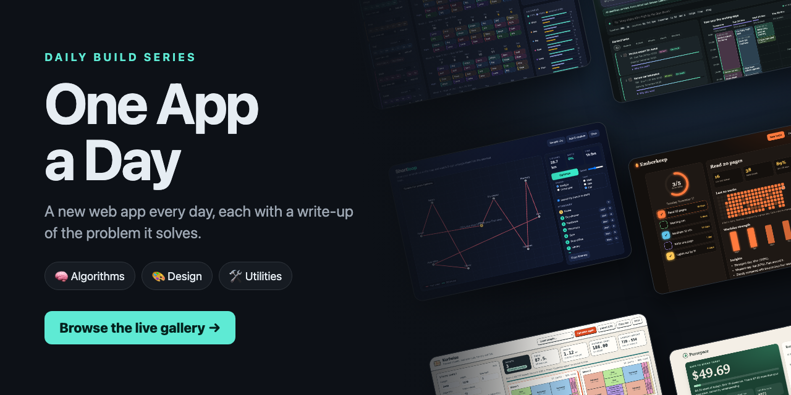

# Hi, I'm Ashwin 👋

**Product & Technical Program Manager in Toronto.** I like turning fuzzy problems into shipped products, and I still build things myself: algorithms, small games, and tools that automate the boring parts.

🌐 [ashwin-thomas.vercel.app](https://ashwin-thomas.vercel.app) · 💼 [All repositories](https://github.com/Ashwin2310?tab=repositories)

---

## ⭐ Featured

### [One App a Day](https://github.com/Ashwin2310/one-app-a-day)
A new single-page web app every day: algorithms and in-browser AI, design tools, and everyday utilities. Each one goes from idea to storyboard to build, is tested in a headless browser, and is published with a write-up of the problem it solves.

**[▶ Browse the live gallery](https://ashwin2310.github.io/one-app-a-day/)** · **[📂 Code and write-ups](https://github.com/Ashwin2310/one-app-a-day)**

## 🧠 Algorithms & AI

<table>
<tr>
<td width="50%" valign="top">

<h3><a href="https://github.com/Ashwin2310/Path-Finding-Algorithm">A* Path Finder</a></h3>
An interactive visualiser: draw walls and watch A* find the shortest route, comparing heuristics. Python · pygame · heapq · tests
</td>
<td width="50%" valign="top">

<h3><a href="https://github.com/Ashwin2310/AIFlappyBird">AI Flappy Bird</a></h3>
Birds teach themselves to fly through the pipes with NEAT neuroevolution, with train and replay modes. Python · neat-python · pygame
</td>
</tr>
</table>

## ☕ Java

<table>
<tr>
<td width="50%" valign="top">

<h3><a href="https://github.com/Ashwin2310/Bank-Account">Bank Account</a></h3>
A Swing banking app with manager and customer roles, State-pattern membership levels, hashed passwords and cents-based money. Java · Swing · design patterns · tests
</td>
<td width="50%" valign="top">

<h3><a href="https://github.com/Ashwin2310/CarTyper">Car Typer</a></h3>
A typing-speed racing game: every correct key moves your car. Two levels, a garage, and live WPM and accuracy. Java · Swing · Java2D
</td>
</tr>
</table>

| Project | What it is | Stack |
|---|---|---|
| [Flight Booking System](https://github.com/Ashwin2310/Flight-Booking-System) | Booking engine with route search, seat limits and polymorphic pricing for members and seniors | Java · records · sealed interfaces |
| [Fireboy & Watergirl remake](https://github.com/Ashwin2310/Fireboy-and-Watergirl-Game-) | 2018 high-school two-player platformer (archived Java Applet) | Java · AWT |

## 🤝 Team projects

| Project | What it is |
|---|---|
| [Smart Fridge UI](https://github.com/Ashwin2310/smart-fridge-ui-test) | University capstone team project (2022–23): interface for a smart-fridge add-on |
| [IKO MRO Items](https://github.com/Ashwin2310/iko_mro_items) | Electron GUI tool for validating maintenance (MRO) item descriptions; I contributed to it |
